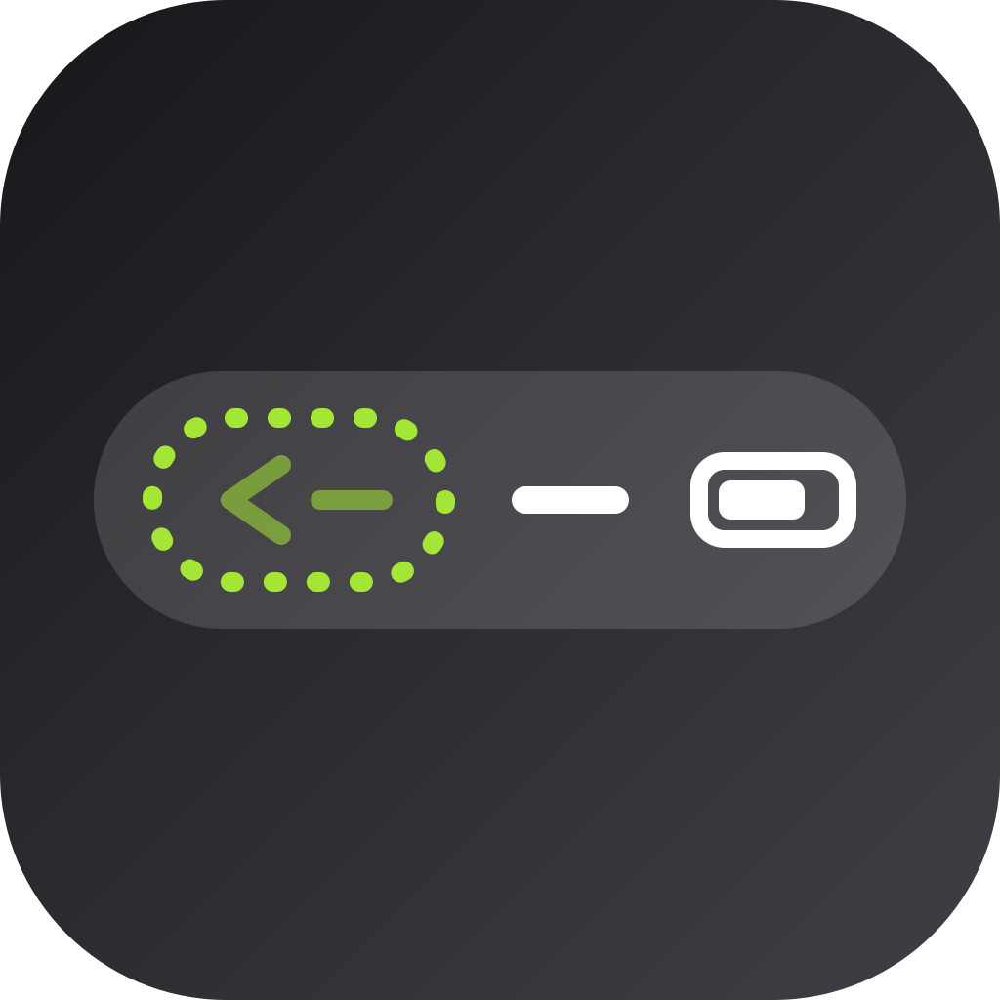

<p align="center">
  
</p>

# Hide Breadcrumbs

<p align="center"><strong>Hide Breadcrumbs is a rootless iOS 18 jailbreak tweak that hides the status bar "Back to App" breadcrumb.</strong></p>

- Package: `com.burc334.hidebreadcrumbs`
- Version: `1.0.0`
- Tested: iOS 18.4.1 (Dopamine 3, roothide) on iPhone 11 Pro Max
- Builds: rootless (`iphoneos-arm64`) and roothide (`iphoneos-arm64e`)
- License: MIT

## Compatibility

| Build | Architecture | Compatibility |
|---|---|---|
| roothide | `iphoneos-arm64e` | Tested on iOS 18.4.1 (Dopamine 3, roothide) |
| rootless | `iphoneos-arm64` | Expected to work on iOS 18+ rootless jailbreaks |

The tweak requires iOS 18.0 or later. The rootless build is expected to work on iOS 18+ rootless jailbreaks.

## What it does

- Hides the "Back to App" breadcrumb in the SpringBoard status bar.
- Leaves time, carrier, signal, Wi-Fi, battery, and other status bar indicators unchanged.
- Removes the breadcrumb before it is created, so there is no leftover gap.
- Applies immediately after respring.
- Does not require a preference pane or configuration.

## How it works

iOS 18 creates the breadcrumb through `SBDeviceApplicationSceneStatusBarBreadcrumbProvider`. Hide Breadcrumbs hooks the provider's decision method and returns `NO`. That is the same decision the system makes when its native `SBNeverBreadcrumb` preference is enabled: the breadcrumb action context is never created, so the status bar item never appears.

## Install

### Sileo

Add `https://burc334.github.io/apt/` in Sileo, then install Hide Breadcrumbs.

### Manual

1. Download the deb matching your jailbreak:
   - roothide: `com.burc334.hidebreadcrumbs_1.0.0_iphoneos-arm64e.deb`
   - rootless: `com.burc334.hidebreadcrumbs_1.0.0_iphoneos-arm64.deb`
2. Install it with Sileo, Zebra, or Filza.
3. Respring.

## Build

```sh
export THEOS=$HOME/theos
make clean package FINALPACKAGE=1
./tools/make-roothide.sh
```

The rootless deb is written to `packages/`. The roothide script converts the latest rootless package to `iphoneos-arm64e`.

## Verification

SHA-256 checksums are published in `SHA256SUMS.txt` with the GitHub release. Verify the downloaded deb before installing it.

## Support

Open an issue on the [GitHub repository](https://github.com/burc334/HideBreadcrumbs/issues). Include your iOS version, jailbreak, device model, and Hide Breadcrumbs version.

## License

MIT

AI-assisted development with DeepSeek-V4.1-Flash-1017.
